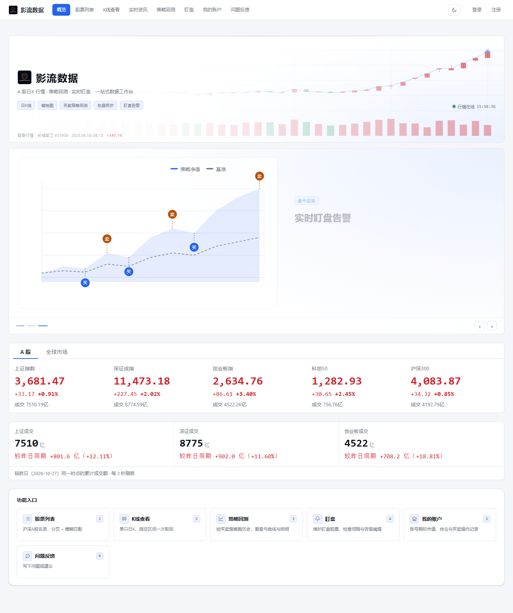
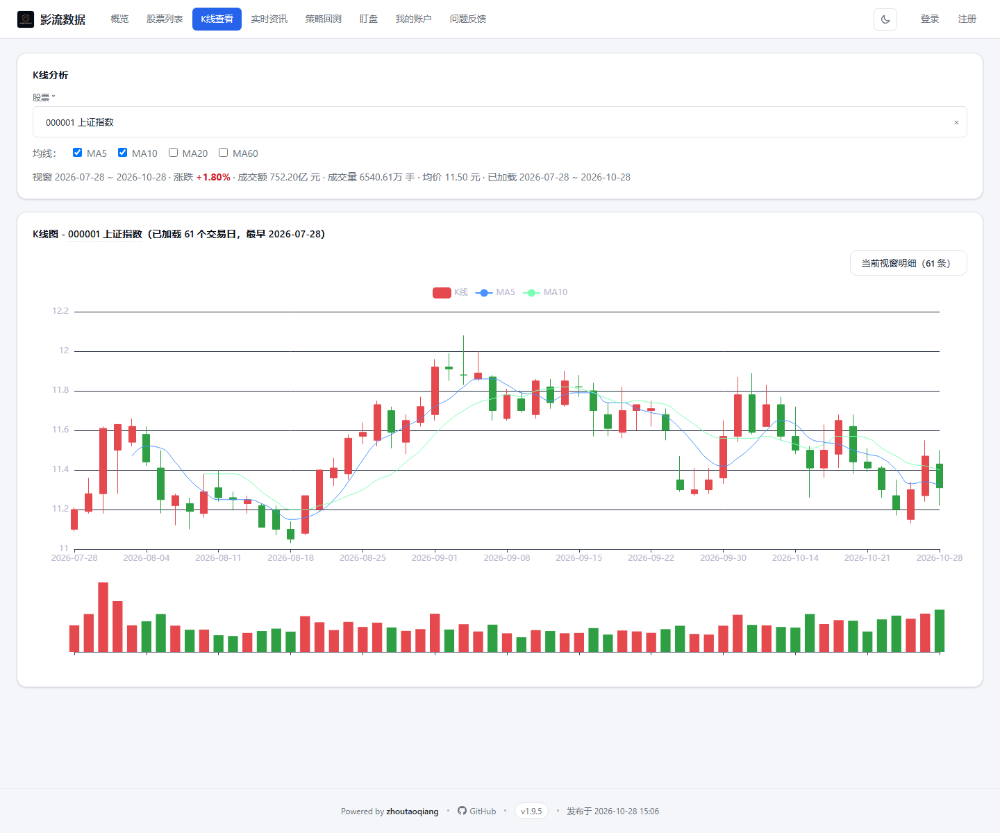

<div align="center">

# 影流数据 · Shadow Flow Data

**A 股日 K 行情 · 策略回测 · 实时盯盘 · 多账户盈亏**

[](https://openjdk.org/)
[](https://spring.io/projects/spring-boot)
[](https://www.mysql.com/)
[](LICENSE)

[线上地址](http://111.231.171.218:8080) · [发布说明](sh/使用说明.md) · [协作规范](AGENTS.md)

</div>



---

## 这是什么

一个自用为主的 A 股数据工作台：行情抓取、K 线查看、策略回测、实时盯盘提醒，
再加上一套按账户核算持仓与盈亏的记录工具。前端是原生 JS + ECharts，没有构建步骤，
后端 Spring Boot 单 jar，可跑 MySQL 也可以纯文件存储。

它不接入券商、不下单，只做**看得清**这件事：数据从哪来、按什么口径算、差多少，都写在页面上。

**行情与数据**
- 沪深 A 股名录，5436 只起
- 日 K 线查看，支持区间与均线
- 市场成交额（上证 / 深证 / 创业板）
- 热门股与板块榜，聚合三家源

**策略与盯盘**
- 自定义买卖条件回测，支持涨跌停成交、滑点与手续费
- 价格偏离 / 封板开板提醒
- 钉钉群机器人推送

**账户**
- 多账户、分批持仓，买卖流水逐笔记
- 当日盈亏 / 总盈亏 / 当日操作盈亏，三个口径分开算
- 单账户打包导出、导入

**权限与运营**
- 邮箱注册 + GitHub 登录
- 超管可代理登录排查问题
- 菜单名称与顺序可配

## 界面

首图是首页：顶部 A 股 / 全球市场两个 TAB，中间三块市场成交额跟昨日同一时点比。

**K 线查看** —— 指定区间一次取回，均线可勾选，副图直接给成交量。



---

## 快速开始

### 1. 环境

JDK 8 与 Maven 3.6+。没有数据库也能跑。

```bash
java -version && mvn -version
```

### 2. 密钥

**密钥只放机器上，不进仓库、不进 jar。** 启动前用 `app.env` 提供，
缺了这个文件、进程里也没有对应环境变量时，服务会直接拒绝启动（而不是带着空口令跑起来）。

```bash
cp shadow-flow-biz/src/main/resources/app.env.example ./app.env
# 填真实值，然后 chmod 600
```

| 键 | 用途 |
| --- | --- |
| `DB_PASSWORD` | 数据库口令，仅数据库模式需要 |
| `ADMIN_PASSWORD` | 超管初始口令，仅首次初始化用 |
| `SHADOWFLOW_API_TOKEN` | 行情数据服务令牌 |
| `DINGTALK_WEBHOOK` | 通知机器人 |

加载顺序：`-Dapp.env.file` → `APP_ENV_FILE` → 工作目录 `./app.env` → 进程环境变量。
服务器上由 `sh/remote.sh` 在启动前逐行注入，所以**换机器只换这个文件**，
不用重新打包，也不会因为谁发的包而改变线上凭据。

行情令牌与机器人还能在「系统配置」页维护，保存即生效，优先级高于 `app.env`。

### 3. 运行

```bash
mvn clean package -DskipTests
java -jar shadow-flow-biz/target/shadow-flow-biz.jar --server.port=8081
```

打开 <http://127.0.0.1:8081/>。

> 若环境变量里存在 `SERVER__PORT`，会覆盖配置里的端口。

---

## 运行模式

由 `shadowflow.db.enabled` 切换，**默认文件模式**，开箱即用。

| 模式 | 开关 | 数据落在哪 |
| --- | --- | --- |
| 文件模式 | `false` | `data/` 下的 JSON |
| 数据库模式 | `true` | MySQL 日 K 表与业务表 |

线上跑的是**数据库模式**。数据库模式首次启动会自动建表（`schema.sql`），
只需预先建一个空库：

```sql
CREATE DATABASE mydb DEFAULT CHARACTER SET utf8mb4 COLLATE utf8mb4_unicode_ci;
```

---

## 数据口径

这几条是踩过坑之后定下来的，改代码前先看一眼。

**指数行情**：A 股走新浪，海外走东方财富（东财主域在部分机房被拒，按备用域降级）。
`/api/market/indices` 每条带 `market` 字段，前端据此分 TAB。

**市场成交额**：上证、深证、创业板各取**该市场全部股票**的成交额。
深证用**综指**不用成指——成指的分时只给 500 只成分股，和实时接口的深市全量差一倍。
「较昨日同期」不是比昨日全天：盘中拿今日累计去比昨日全天，上午永远是大负数，
所以按 1 分钟 K 线取两天走过同样多的分钟数再相减。

**账户盈亏**是三个不同的东西，别混：

| 口径 | 算什么 |
| --- | --- |
| 当日盈亏 | 今日浮动 + 今日已实现 |
| 总盈亏 | 持仓市值 + 可用 − 期初市值 |
| 当日操作盈亏 | 今日每笔操作放到现价值多少 |

当日操作盈亏 = Σ买入（现价 − 买价）× 量 + Σ卖出（卖价 − 现价）× 量。
买入后涨了算正，卖出后跌了也算正。记录列表里**只有今天买入的**才有盈亏，
历史买入拿今天的价去算那不叫盈亏。

---

## 技术栈

| 层 | 选型 |
| --- | --- |
| 后端 | Java 8 / Spring Boot 2.7.6 / JdbcTemplate |
| 前端 | 原生 JavaScript / ECharts / 原生 CSS |
| 存储 | MySQL 8.0 或本地 JSON |
| 构建 | Maven 3.6+ |

工程是 Maven 聚合，`groupId` = `io.github.zhoutaoq`：

```
shadow-flow-parent      聚合 pom
├── shadow-flow-notify  通知 SDK：通道 / 目标解析 / 时段闸门，不含业务词
└── shadow-flow-biz     Web 服务与页面，产物 shadow-flow-biz.jar
```

`notify` 是可直接复用的通用能力，业务文案由 `biz` 组装后传入，两边不互相污染。

---

## 主要接口

接口都挂在 `/api` 下：

| 接口 | 说明 |
| --- | --- |
| `GET /market/indices` | 十个指数快照，带 `market` 分组 |
| `GET /market/turnover` | 三市成交额 + 较昨日同期 |
| `GET /account/summary` | 账户汇总，不带 `accountId` 即全部账户合计 |
| `GET /account/records` | 买卖流水，今日买入带浮动盈亏 |
| `GET /kline/chart` | K 线数据，ECharts 直接用 |
| `POST /backtest/run` | 执行策略回测 |

除 `backtest` / `watch` / `account` / `admin` 需要登录外，其余匿名可读。

---

## 注意事项

1. **调用量**：文件模式下每次预览都实时请求行情服务，批量更新超过 20 只会先弹二次确认。
2. **盯盘开关**：钉钉机器人需配 Keyword 或 Secret，否则消息会被拦。
3. **股票范围**：仅沪深 A 股（60 / 68 / 00 / 30 开头）。
4. **可用数量**：每日 00:00（北京时间）自动把「可用数量」对齐到「持仓数量」。
5. **行情延迟**：免费接口本身有延迟，页面上的时间戳是服务端取数时刻，不代表交易所时间。

---

## 开发与发布

分支从 `github` 切出，走 PR，提交信息末尾必须带模型名：

```
fix(account): 汇总接口漏了当日操作盈亏

Model: dsv4.1flash
```

自测：

```bash
mvn -B clean package -DskipTests
node scripts/check_inline_js.js shadow-flow-biz/src/main/resources/static
```

发布由 `sh/remote.sh` 完成：停旧 → 备份 → 换 jar → 启动 → 探活。
本地快发脚本在 `.idea/scripts/deploy_local.py`（不入库），线上凭据从 `sh/deploy.env` 读。

提交前自检密钥：

```bash
git diff --cached | grep -inE 'password|secret|token|webhook'
```

---

<div align="center">

Apache License 2.0 · 行情数据来自公开接口，仅供学习研究，不构成投资建议

</div>
